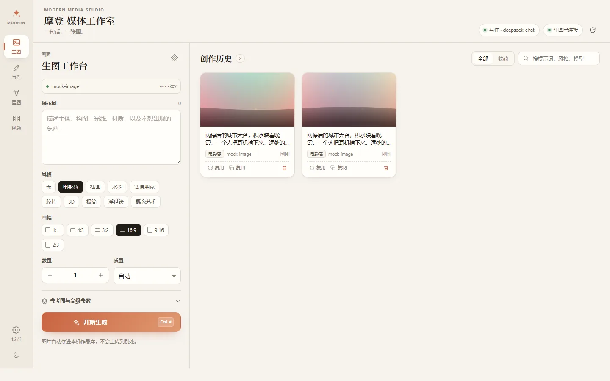
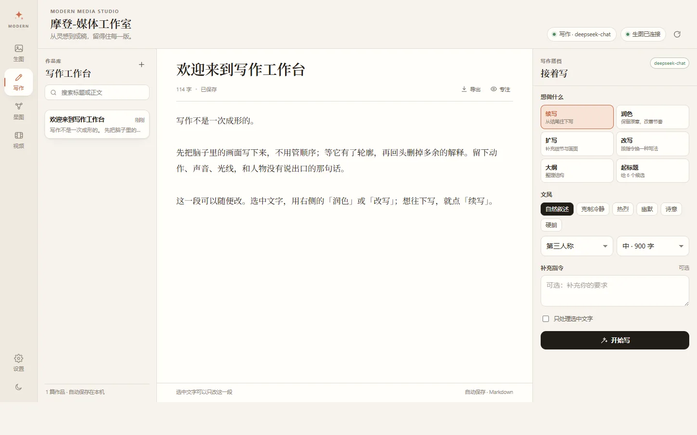
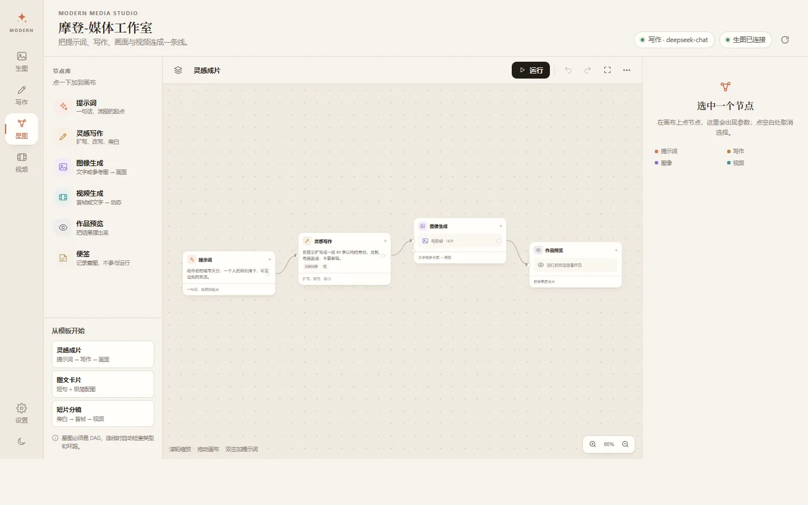
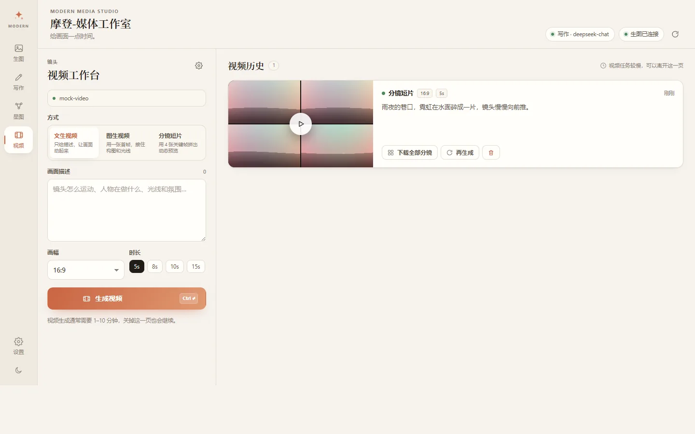

# 摩登-媒体工作室 · @exccoder/dsh-media-workbench

一个 DeepSeek Harness（DSH）插件。装上之后，DSH 侧栏会多一个「摩登-媒体工作室」，里面是四个连在一起的工作台：

- **生图工作台**：一句话出图，风格、画幅、数量、最多 8 张参考图队列、收藏与历史。
- **视频工作台**：文生视频、图生视频，以及不消耗视频额度的「分镜短片」。
- **写作工作台**：作品库、长文编辑器、续写/润色/扩写/改写/大纲/起标题，流式生成。
- **星图工作台**：把提示词、写作、图像、视频接成 DAG，逐波并行运行，可存成蓝图复用。

写作走 DSH 当前默认模型；生图和视频各自配置自己的接口。作品、图片、视频、星图都留在本机，不上传云端。界面支持中文 / English，并跟随 DSH 的语言和明暗主题。

GitHub：[ExcCoder/modern-dsh-media-workbench](https://github.com/ExcCoder/modern-dsh-media-workbench)

## 界面

| 生图工作台 | 写作工作台 |
| --- | --- |
|  |  |
| **星图工作台** | **视频工作台** |
|  |  |

> 截图里的画是本地 mock 生图生成的占位图，用来演示链路；接上真实生图服务后就是模型出的图。

## 安装

要求 DSH `0.2.x`（插件在 `0.2.2-rc.1` 上验证）。

**方式一：插件管理。** 在 DSH 里打开「插件 → 添加插件」，选择本目录（或打包后的 tgz）。

**方式二：命令行。**

```bash
# 发布到 npm 之后
dsh plugin --profile desktop add @exccoder/dsh-media-workbench

# 从本地目录安装
dsh plugin --profile desktop add /absolute/path/to/dsh-media-workbench
```

装好后**完全退出 DSH 再打开**，侧栏出现「摩登-媒体工作室」。卸载用 `remove @exccoder/dsh-media-workbench`；你的作品在 `~/.dsh/media-workbench-modern/`，不会跟着删。

> 本地目录安装会以 `link:` 方式直接引用源码；想把插件挪到别处或打包分发，用 `npm pack` 生成 tgz 再安装。

## 第一次使用

### 生图

1. 打开「设置 → 生图服务」，选一个预设（OpenAI / 硅基流动 / 智谱 / 火山方舟），或选「自定义」。
2. 填接口地址、模型和密钥，保存，点「试画一张」确认能通。
3. 回生图工作台写提示词，选风格和画幅，生成。

任何兼容 OpenAI Images API 的服务都能用：`POST {baseUrl}/images/generations`；上传参考图时走 `POST {baseUrl}/images/edits`（multipart，单张字段 `image`，多张按顺序用 `image[]`）。返回 `data[0].b64_json`、`images[0].url` 两种常见形状都支持。

参考图支持拖入、文件多选和 **Ctrl+V 粘贴**，最多 8 张，按「图一、图二…」编号，可以上移/下移。图片右键可以复制图片到剪贴板、下载原图、复制提示词或打开所在目录；复用带参考图的记录时会询问是覆盖当前参考图，还是只复用提示词。

### 视频

- **文生视频 / 图生视频**：填接口地址、模型、密钥，默认按 `POST /videos` 创建、`GET /videos/{id}` 轮询、`GET /videos/{id}/content` 取文件。路径可以在设置里改，`{id}` 会替换成任务 id。
- **分镜短片**：不需要视频服务，用生图服务画 4 张关键帧，在浏览器里按节奏交叉淡入播放，也可以逐张下载。

视频任务在后台继续跑，离开这一页不会中断。

### 写作

写作不需要额外密钥，直接用 DSH 里选好的模型。左边是作品库，中间写，右边是写作搭档：

- 选中一段文字，勾上「只处理选中文字」，点「润色」「扩写」「改写」就只改这一段。
- 生成是流式的，可以随时停；结果可以追加、替换、插入光标、复制或丢弃。
- 正文自动保存到本机，导出为 Markdown。

### 星图

- 左侧节点库点一下加节点；从节点右侧圆点拖到另一个节点的输入端口就连线。
- 连线会检查类型（文本 / 图像 / 视频 / 作品）、单输入限制和环路，不合法会直接说明原因。
- 「运行」按拓扑波次并行；失败的上游只阻断它的后代，其他分支继续跑。
- 选中节点可以「运行到这里」，只跑它和它的祖先。
- 「更多 → 保存为蓝图」把当前结构存下来（不含运行结果），之后从「更多 → 我的蓝图」整张复用。

快捷键：`Ctrl/Cmd+Enter` 运行，`Delete` 删除选中的节点或连线，`Ctrl/Cmd+Z` 撤销，`F` 适应画布，滚轮缩放，拖空白平移，双击画布加提示词节点。

## 给智能体的工具

插件同时注册了 5 个模型工具，所以 DSH 在对话里也能直接用工作台：

| 工具 | 作用 |
| --- | --- |
| `modern_media_generate_image` | 按提示词生成 1–2 张图，存进生图历史，返回本机路径 |
| `modern_media_save_document` | 把稿子保存进写作工作台 |
| `modern_media_generate_video` | 生成视频或分镜短片，默认等到完成 |
| `modern_media_run_star_map` | 运行一张星图，或从模板新建后运行 |
| `modern_media_workspace_overview` | 看最近的作品、文档和星图，方便接着做 |

## 数据与安全

- 数据目录：`$DSH_HOME/media-workbench-modern/`（默认 `~/.dsh/media-workbench-modern/`）。图片和视频的文件主目录可以在「设置 → 作品文件目录」换到其他盘，保存时会迁移已有文件并删除旧文件；作品记录和设置仍留在默认数据目录。
  - `state.json`：图片/视频记录、写作文档、星图、蓝图
  - `settings.json`：接口地址、模型、密钥，权限 `600`
  - `files/`：生成的图片、视频和上传的参考图
- 密钥只存在本机，返回浏览器时只给「有没有密钥」和尾四位。
- 所有写接口校验同源与 DSH 登录凭据；静态文件只服务 `web/` 白名单；文件下载只接受 `files/` 下的安全文件名。
- 下载远端图片/视频前会拒绝本机、内网和云元数据地址，避免 SSRF。
- 模型输出、导入的星图都按固定字段和数量上限收敛；星图导入会丢弃悬空、重复、类型不符和成环的连线。

## 开发

```bash
node tools/dev-server.mjs     # 本地预览：http://127.0.0.1:7788/media-workbench-modern/
node --test tools/verify.mjs  # 离线验证：DAG、导入修复、存储、密钥脱敏、提示词
npm pack                      # 打出可安装的 tgz
```

本地预览不启动 DSH，也不需要密钥：生图和视频走内置 mock，写作走本地假流。预览数据在 `.dev-home/`，删掉即可重来。

```
src/          host 半片：HTTP 路由、本机存储、生图/视频/写作/星图执行、模型工具
lib/client.js 浏览器半片：侧栏入口 + 主区域 iframe
web/          工作台界面（原生 ES modules，无构建步骤）
tools/        本地预览和离线验证脚本
```

## 已知限制

- 视频接口各家差异较大。当前按「异步任务 + 轮询」的通用形状实现，特殊服务商需要在设置里改路径或参数；不兼容时会给出明确错误，不会静默降级。
- 没有视频服务时，只有「分镜短片」模式可用（4 张关键帧），不会在本地合成 mp4。
- 生图密钥只支持单个当前配置，不做多账号轮换。
- 移动端窄屏会收起作品库、星图节点库和检查器；它们的主要操作仍可在画布或设置里完成。

## 开源与发布

- 许可证：MIT，见 [LICENSE](LICENSE)。
- 变更记录：[CHANGELOG.md](CHANGELOG.md)。
- 安全问题：[SECURITY.md](SECURITY.md)。
- 参与开发：[CONTRIBUTING.md](CONTRIBUTING.md)。
- 发布到 npm / GitHub 的步骤：[PUBLISHING.md](PUBLISHING.md)。
- npm 包名 `@exccoder/dsh-media-workbench` 使用 npm 账号 `exccoder` 的用户 scope，发布不需要组织权限；改用其他 scope 时需要同步四处包名，见 [PUBLISHING.md](PUBLISHING.md)。

## 许可

MIT。与 DeepSeek 官方无关；DSH 的名称和标识归其所有者。
